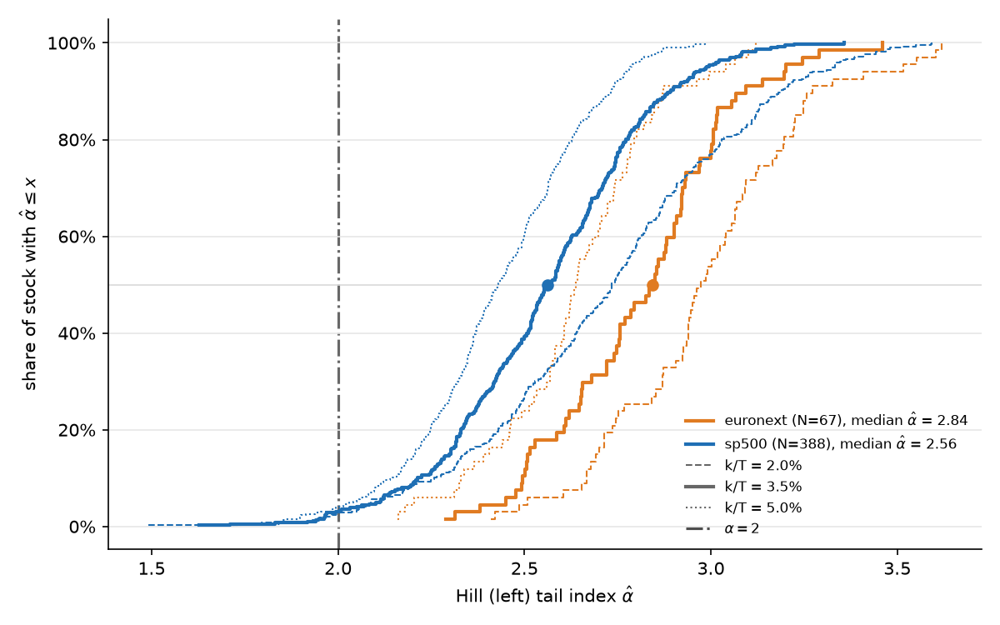
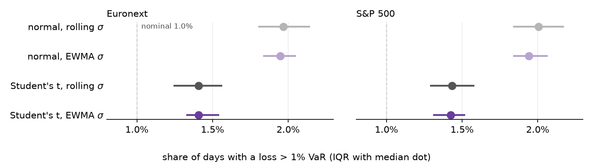
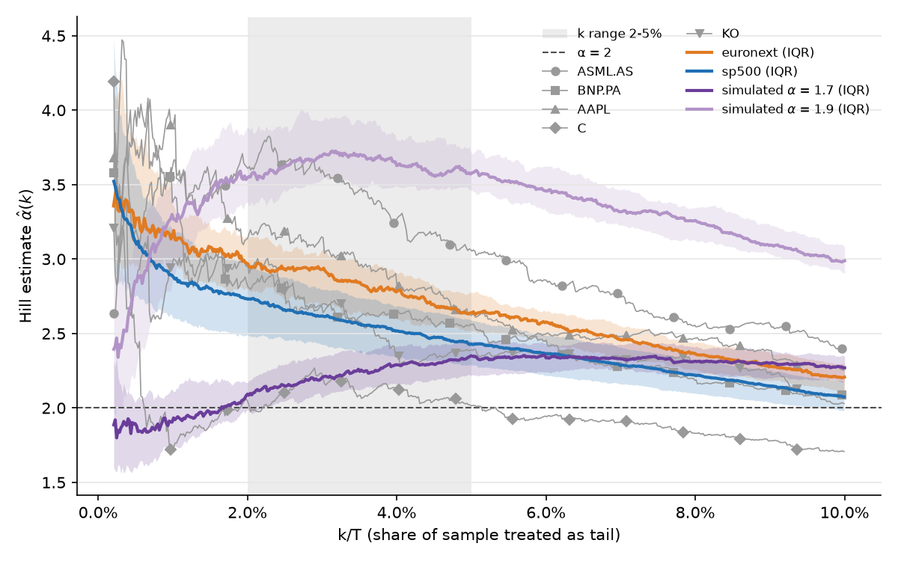
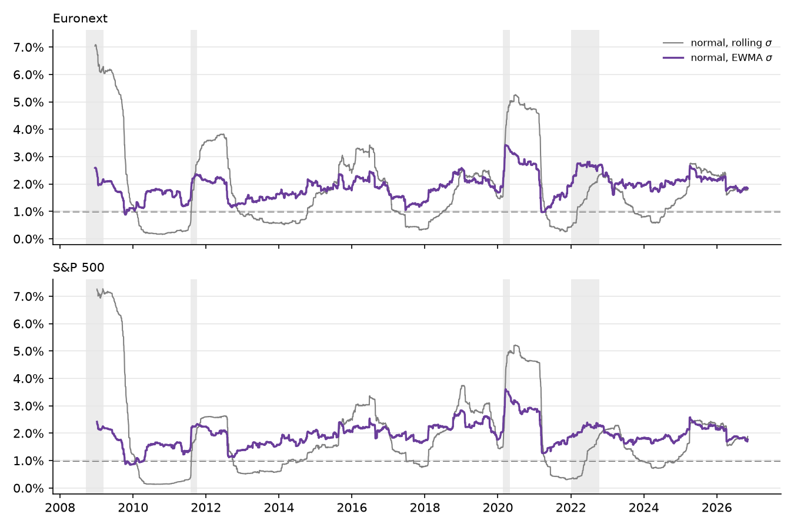

# Tail risk in market returns

**How heavy are the tails of individual stock returns, and how much does a normal model understate a 1% daily loss risk?**

<p>
  
  
</p>


## Findings 

1. Daily losses of individual stocks have median tail indices (Hill) of about 2.4-3.0 depending on $k$
    - Heavier-tailed than a normal distribution model
    - but the shape of the Hill curves are inconsistent with *iid.* $\alpha$-stable returns
1. A normal $1\%$ Value-at-Risk is breached on about $2\%$ of days, twice the nominal rate. Whether volatility is estimated over two years or with an EWMA
    - A Student-t quantile (fitted $\nu \approx 4-6$, a $10-14\%$ larger VaR) lowers breach to about $1.4\%$
    - It still fails the coverage test for most stocks
1. The quantile sets *how often* breaches occur, the volatility models sets *when*
    - EWMA removes most of the breach clustering, but not their excess frequency

## Data

- Daily log returns, 2006-01-01 to 2026-11-06 (≈ 5,250 trading days): 387 S&P 500 stocks and 66 Euronext stocks
- `losses` are defined as $L = −r$
- Raw data is cleaned with `scripts/logreturns.py` in the following order
  1. fixed start date
  1. tickers with < 2% missing prices
  1. exchange holidays removed
  1. forward fill of at most 3 days
  1. stale tickers (> 5% zero returns) dropped
- The data itself is not included in the repo, it can be manually retrieved via the python package `yfinance`
    - To precisely use the same dataset, a sister-repo has a download script [available here](https://github.com/ahaaster/robust-covar/blob/master/scripts/collect_data.py)


## Method

### Tail index (Hill)
The Hill estimator is the maximum-likelihood estimator of a Pareto tail fitted to the $k$ largest losses ordered from largest to smallest:
```math
\begin{aligned}
\hat{\alpha}(k) &= \bigg[ \tfrac1k \sum_{i=1}^k \big(\ln(L_{(i)}) - \ln(L_{(k+1)}) \big) \bigg]^{-1} \\
SE &\approx \frac{\hat{\alpha}}{\sqrt k}  \quad (iid.)
\end{aligned}
```
The whole curve is computed with a cumulative sum and vectorised mapping across all stocks in JAX.
$\hat{\alpha}$ falls steadily with $k$ and has **no plateau** of stable values, 
so results are reported at $k/T = \{0.02, 0.035, 0.05\}$ instead of a single value $k$.


### Stable-law benchmark
To check what Hill reports for truly infinite-variance data, the same pipeline is run on iid. symmetric $\alpha$-stable samples ($\alpha = 1.5, 1.7, 1.9; T = 5250; N = 50$ each with a fixed seed)

### Value-at-Risk backtest
A 2-by-2 design with normal vs Student-t quantiles and a rolling 2-year window (504 days) vs exponentially weighted moving average (EWMA) standard deviations.
Daily $1\%$ Value-at-Risk forecast each day using only data up to the previous day:

| | rolling σ (504 days) | EWMA σ (λ = 0.94) |
|---|---|---|
| **normal quantile** | "normal, rolling $\sigma$" | "normal, ewma $\sigma$" |
| **Student-t quantile** | "Student's t, rolling $\sigma$ | "Student's t, ewma $\sigma$" |

#### $\sigma$ method 
equal-weighted mean of squared returns over 2 years or EWMA with a warm-up on the first 2 years.
$\hat{\mu} = 0$.
All four models are tested on the same forecast days

#### Student-t
$\nu$ is fitted by grid maximum likelihood on standardised returns ($z$) on an expanding window refitted yearly.
```math
\nu \in [2.5, 30]\text{, step } 0.1; \quad z = r / \hat{\sigma}
```
Quantiles are precomputed for the grid using `scipy.stats.t.ppf`, because JAX does not have the relevant method available for the $t$-distribution.

#### Tests
Tests are done per stock individually instead of pooled.
That is because breaches move together across stocks:
- Kupiec unconditional coverage:
```math 
\begin{aligned}
LR &= -2 \bigg[ \ell(p_0) - \ell(x/T) \bigg] \\
\ell(\pi) &= (T - x) ln(1 - \pi) + x ln(\pi)
,\quad \chi^2 (1)
\end{aligned}
```
- Christoffersen independence: Markov-chain LR on the four breach transition counts, $\chi^2 (1)$

Reported as the share of stocks rejected at the $5\%$ level.
By chance rejection is expected to be about $5\%$ if the model is correct.

## Results

### Tail indices


<!-- hill_summary_table:start -->
| market   | k/T   |   k |   median $\hat{\alpha}$ | share $\hat{\alpha} < 2$   |
|:---------|:------|----:|------------------------:|:---------------------------|
| Euronext | 2.0%  | 106 |                    2.97 | 0.0%                       |
| Euronext | 3.5%  | 186 |                    2.84 | 0.0%                       |
| Euronext | 5.0%  | 266 |                    2.64 | 0.0%                       |
| S&P 500  | 2.0%  | 104 |                    2.73 | 2.6%                       |
| S&P 500  | 3.5%  | 183 |                    2.56 | 3.1%                       |
| S&P 500  | 5.0%  | 262 |                    2.43 | 4.1%                       |
<!-- hill_summary_table:end -->

Estimates sit below the $3-4$ often reported,
but this depends on $k$ ($\hat{\alpha}$ falls with $k$)
and on the sample including 2008 and 2020.
The market bands in the figure show the spread across stocks,
which is only modestly wider than the pure estimation noise visible in the simulated bands.

Citigroup ($\hat{\alpha} \approx 2$) owes its heavy tail almost entirely to Nov 2008 - Apr 2009.


### Value-at-Risk backtest


<!-- var_summary_table:start -->
| market   | model                         | median rate exceeded   | IQR-band    | share rejected coverage (5%)   | share rejected indep. (5%)   |
|:---------|:------------------------------|:-----------------------|:------------|:-------------------------------|:-----------------------------|
| Euronext | normal, rolling $\sigma$      | 1.97%                  | 1.80%-2.14% | 98.5%                          | 89.6%                        |
| Euronext | normal, EWMA $\sigma$         | 1.95%                  | 1.83%-2.05% | 100.0%                         | 37.3%                        |
| Euronext | Student's t, rolling $\sigma$ | 1.41%                  | 1.24%-1.56% | 67.2%                          | 80.6%                        |
| Euronext | Student's t, EWMA $\sigma$    | 1.41%                  | 1.33%-1.54% | 80.6%                          | 19.4%                        |
| S&P 500  | normal, rolling $\sigma$      | 2.00%                  | 1.84%-2.17% | 99.5%                          | 85.1%                        |
| S&P 500  | normal, EWMA $\sigma$         | 1.94%                  | 1.84%-2.07% | 100.0%                         | 22.7%                        |
| S&P 500  | Student's t, rolling $\sigma$ | 1.43%                  | 1.29%-1.58% | 73.2%                          | 74.7%                        |
| S&P 500  | Student's t, EWMA $\sigma$    | 1.42%                  | 1.31%-1.52% | 77.3%                          | 19.1%                        |
<!-- var_summary_table:end -->

- With a rolling $\sigma$ the normal model is badly mistimed:
    - Up to $5-7\%$ breaches after calm periods (see 2008, 2020) and $0.2-0.5\%$ after turbulent ones
    - EWMA flattens this to $1.5-2.5\%$ throughout
- The spread across stocks is close to pure binomial noise (expected IQR $\approx 0.27$ pp at a $2\%$ rate)
    - So, the model fails about equally for all stocks
- Fitted $\nu$: median $3.9-4.3$ with rolling $\sigma$, $5.3-5.9$ with EWMA
    - Standardising by a rolling $\sigma$ leaves fatter tails
    - So, its larger $t$ quantile compensates for the worse $\sigma$
    - This is why both $t$-models land at $1.4\%$
- The remaining excess of $1.4\%$ is likely because $\nu$ is fitted on all standardised returns
    - So, the many calm days, rather than the tail events, determine the quantile


### So is $\alpha < 2$?

$\alpha$-stable dsitributions with tail index $\alpha < 2$ imply infinite variance. 
Nearly all stocks evaluated have $\hat{\alpha} > 2$, yet stable returns can't be ruled out:
Hill is found to be biased upward for stable data, increasingly so as $\alpha \to 2$ as described in McCulloch (1997).

Simulated data brackets the stock estimates, where a stable law with
- $\alpha = 1.7$ gives $\hat{\alpha} \approx 2.1-2.35$
- $\alpha = 1.9$ gives $\hat{\alpha} \approx 3.6$

| true $\alpha$ | $\hat{\alpha} \big(k/T = 2\% \big)$ | $3.5\%$ | $5\%$ |
|---|---|---|---|
| 1.5 | 1.62 | 1.65 | 1.71 |
| 1.7 | 2.09 | 2.25 | 2.35 |
| 1.9 | 3.55 | 3.70 | 3.58 |

The **shape** of the Hill curves does discriminate: 
for simulated stable data $\hat{\alpha}$ starts near the true $\alpha$ and rises with $k$, while for stocks it starts high and falls. 
That makes the data inconsistent with *iid.* stable returns. 


## Caveats
- **Survivorship bias:** the sample consists of current index members with near-complete history since 2006. Firms that failed (e.g. Lehman Brothers) are missing, so tails are likely understated.
- **Choice of $k$:** there's no plateau in the Hill curves, so estimates are reported at three values of $k$.
- **Volatility clustering:** violates Hill's *iid.* assumption. The estimator stays consistent for GARCH-type processes, but its standard errors are too small.
- **Cross-sectional dependence:** crises hit all stocks at once (visible as near-identical curves for both markets), so no pooled tests are used.
- **Overlapping windows:** consecutive rolling forecasts share almost all their data. The testable consequence, clustered breaches, is what the Christoffersen test measures.
- **Multiple testing:** with 387 tests at $5\%$, about 19 rejections are expected by chance.
<!-- - **Euronext:** only 66 stocks across several exchanges. -->
- **$\lambda$ and the refit schedule are fixed by convention,** not tuned to the backtest.


## How to use/reproduce

```bash
uv sync
# uv run --extra data python scripts/collect_data.py   # see Data section
uv run scripts/logreturns.py  # needs raw price data in data/ to clean
uv run pytest
uv run scripts/run_analysis.py
```

## Future work
- Include darkmode versions of the figures to not have an eyesore
- A GPD (peaks-over-threshold) tail for the VaR quantile, which fits only the tail
- The 0.1% VaR level, where tail shape matters more
- Intraday, lower-frequency (weekly/monthly), FX and crypto returns

<!-- ## References
Hill (1975); McCulloch (1997); Kupiec (1995); Christoffersen (1998); J.P. Morgan/Reuters, RiskMetrics Technical Document (1996). -->